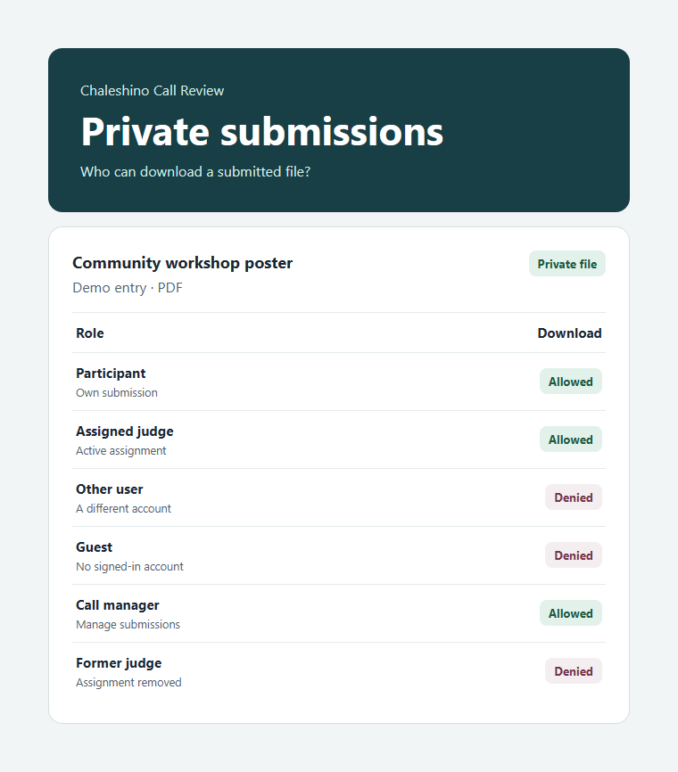
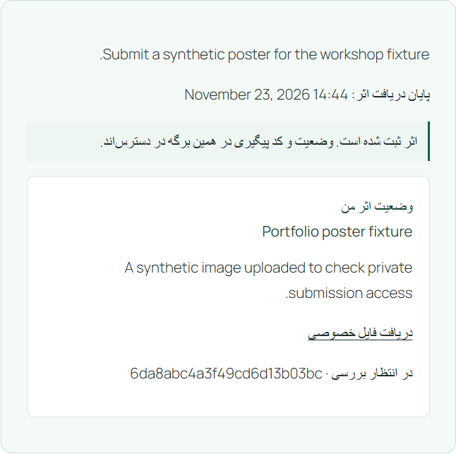

# Chaleshino Private Submissions

Participants submit entries for review. The file stays in private storage, and the download policy grants access to the participant, an assigned judge, or a call manager.

The sample uses the storage class and download access methods from Chaleshino Call Review. The test checks policy decisions with synthetic WordPress identities. The full plugin handles the upload and checks access before it serves the saved file.

The WordPress test submitted a synthetic image and confirmed access for the owner and assigned judge. A different account and the same judge after assignment removal did not receive the file.

    php tests/check.php

The checks cover the participant, an assigned judge, another user, a guest, a call manager and a judge whose assignment was removed. Run `php tests/check.php --html > examples/access-preview.html` to view the same tested decisions for a fictional entry.

See [NOTICE](NOTICE.txt) for attribution and [LICENSE](LICENSE.txt) for the original license. The separate [review workflow](https://github.com/aa71200/chaleshino-review-workflow) covers scoring and result publication.
